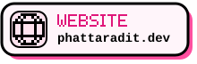
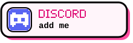
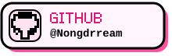
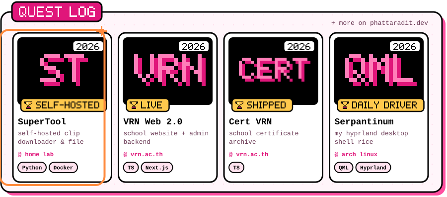
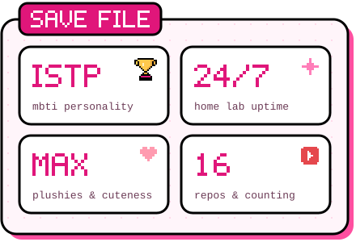

<!--
  · all the text on the cards lives in scripts/profile.mjs → edit it, then run:  node scripts/build.mjs
  · preview locally:  node scripts/build.mjs preview  → open preview/index.html
  · header, status and skate log are redrawn daily by .github/workflows/daily.yml → `output` branch
-->

   

 

design from <a href="https://github.com/poomp5/poomp5">@poomp5</a> 🎀

